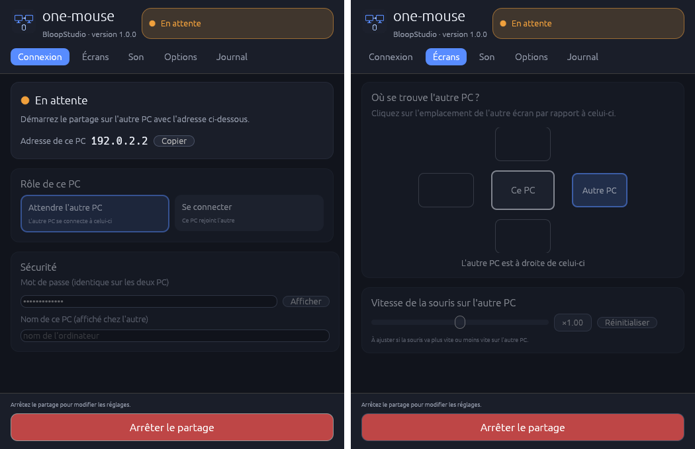

<p align="center">
  
</p>

<h1 align="center">one-mouse</h1>

<p align="center">
  <b>Une seule souris et un seul clavier pour deux PC posés côte à côte</b><br>
  Windows · Linux · macOS — par <b>BloopStudio</b>
</p>

<p align="center">
  <a href="https://github.com/TheDEMON78/one-mouse/releases/latest"></a>
  <a href="https://github.com/TheDEMON78/one-mouse/actions/workflows/ci.yml"></a>
  <a href="https://github.com/TheDEMON78/one-mouse/releases"></a>
  <a href="LICENSE"></a>
</p>

Poussez le curseur contre le bord de l'écran : il passe sur l'autre PC, comme sur un écran supplémentaire. Le clavier
suit, le presse-papier est partagé, et le son de l'autre PC arrive dans votre casque.

Ce n'est **pas** du bureau à distance : aucune image n'est transmise, chaque PC garde son propre écran.

<p align="center">
  
</p>

## Fonctionnalités

- 🖱️ **Souris et clavier partagés** : le curseur franchit le bord de l'écran, dans les deux sens, entre Windows, Linux
  et macOS (n'importe quelle combinaison). **Un seul curseur visible** : celui du PC utilisé (Windows, Linux X11).
- 🖥️ **Disposition des écrans** : l'onglet Écrans montre les écrans des deux PC (plusieurs écrans par PC) ; faites
  glisser ceux de l'autre PC pour les aligner. Le curseur passe d'un PC à l'autre **à la même hauteur** (Windows,
  Linux X11).
- 📋 **Presse-papier partagé** : texte, images et fichiers. Copiez sur un PC, collez sur l'autre avec Ctrl+V (les
  fichiers copiés sont transférés, 1 Go au plus par copie). **Historique** des 20 dernières copies des deux PC
  (onglet Presse-papier), effacé à la fermeture.
- 📁 **Glisser-déposer d'un écran à l'autre** : glissez des fichiers jusqu'au bord de l'écran, vers l'autre PC ; une
  zone « Déposer ici » apparaît sous le curseur. Lâchez-les dessus : ils arrivent sur l'autre PC dans
  « Téléchargements/one-mouse », s'y affichent dans l'explorateur (d'où on continue à les glisser où l'on veut) et
  sont dans son presse-papier (Ctrl+V). On peut aussi les glisser sur la fenêtre one-mouse.
- 🔊 **Son de l'autre PC dans votre casque, en permanence**, sans perte (flottants 32 bits), en UDP chiffré.
- 🎙️ **Votre micro devient celui de l'autre PC** : Discord, Teams… l'utilisent sans réglage.
- 🎯 **Vitesse de la souris réglable** sur l'autre PC, si les deux n'ont pas la même sensibilité.
- 🔒 **Connexion chiffrée** par mot de passe (Argon2id, ChaCha20-Poly1305).
- 🔎 **Découverte automatique** : les deux PC se trouvent seuls sur le réseau local, sans adresse à saisir.
- 🔄 **Mises à jour automatiques** : chaque nouvelle version s'installe seule, les deux PC restent à la même version.
- 📶 **Par le réseau ou par Bluetooth** : câble ou Wi-Fi (recommandé), ou liaison Bluetooth directe entre les deux PC.
- 🪟 **Reste dans la barre des tâches** (Windows) : fermer la fenêtre garde one-mouse près de l'horloge.
- 🔒 **Verrouillage commun** : verrouiller un PC (Windows+L) verrouille l'autre ; aucun ne s'endort pendant la
  connexion.
- ⏰ **Réveil à distance** : au démarrage du partage, l'autre PC en veille est réveillé par le réseau (Wake-on-LAN, voir [Réveil à distance](#réveil-à-distance)).
- 🚀 **Démarrage automatique** à l'ouverture de session, partage lancé tout seul.
- 📦 **Installateurs** générés automatiquement à chaque version.

## Installation

Téléchargez l'installateur de la [dernière version](https://github.com/TheDEMON78/one-mouse/releases/latest) et
installez **la même version sur les deux PC** :

| Système | Fichier |
| --- | --- |
| Windows | `one-mouse_X.Y.Z_x64-setup.exe` ou `.msi` |
| macOS Apple Silicon (M1, M2…) | `one-mouse_X.Y.Z_aarch64.dmg` |
| macOS Intel | `one-mouse_X.Y.Z_x64.dmg` |
| Linux | `.deb` (Debian, Ubuntu…) ou `.AppImage` |

## Mises à jour

one-mouse vérifie les nouvelles versions au démarrage puis toutes les 6 heures (onglet Options → Mises à jour).

- **Windows** et **Linux (AppImage)** : la nouvelle version est téléchargée, son empreinte SHA-256 vérifiée, puis elle
  est installée dès que la souris ne contrôle aucun PC ; one-mouse redémarre seul (et relance le partage si l'option
  est cochée). Laissez l'option activée sur les deux PC : ils gardent toujours la même version.
- **macOS** et **Linux (.deb)** : la fenêtre signale la nouvelle version et ouvre sa page de téléchargement.

## Démarrage rapide

Ouvrez **one-mouse** sur les deux PC (même réseau local) :

1. Sur le premier PC, laissez « Attendre l'autre PC ».
2. Sur le second PC, choisissez « Se connecter ». **Aucune adresse à saisir** : il trouve tout seul, sur le réseau
   local, le PC qui attend avec le même mot de passe (l'adresse reste possible, par exemple à travers un VPN).
3. Sur les deux PC : saisissez le **même mot de passe** (8 caractères minimum), indiquez dans l'onglet Écrans de quel
   côté se trouve l'autre PC, puis cliquez sur **Démarrer le partage**.
4. Sur le PC où sont branchés la souris, le clavier et le casque, cochez « Ce PC est mon PC principal » (onglet Son).

Poussez ensuite le curseur contre le bord de l'écran situé du côté de l'autre PC pour passer dessus, et contre le bord
opposé pour revenir.

> **Raccourci de secours** pour reprendre la main : `Ctrl` + `Maj` + `Alt` + `Méta` (touche Windows / Cmd).

Les réglages sont enregistrés. Les options « Démarrer le partage à l'ouverture de one-mouse » et « Lancer one-mouse à
l'ouverture de session » rendent tout automatique. Sous Windows, one-mouse démarre alors directement dans la zone de
notification ; fermer la fenêtre l'y garde (clic sur l'icône pour la rouvrir, clic droit → **Quitter** pour fermer).

## Liaison par Bluetooth

Sans réseau commun, les deux PC peuvent se relier **directement en Bluetooth**, sans adresse à saisir (Windows et
Linux). Choisissez **Bluetooth** dans « Liaison entre les deux PC » (onglet Connexion) sur les deux PC.

1. **Une seule fois** : démarrez le partage sur le PC qui attend (il devient visible en Bluetooth), puis sur l'autre
   PC cliquez sur **Associer en Bluetooth**, choisissez le premier PC et confirmez le code affiché sur les deux.
   Cette confirmation est imposée par le système, pour la sécurité : aucune application ne peut la faire à votre place.
2. **Ensuite** : démarrez simplement le partage sur les deux PC. Celui qui se connecte cherche tout seul, parmi les PC
   associés, celui qui attend avec one-mouse, et se reconnecte automatiquement.

**Savoir par où ça passe** : pendant le partage, l'onglet Connexion indique la liaison (« Bluetooth », « réseau local —
son sans perte en UDP » ou « … par TCP »). En mode Bluetooth, avant la connexion, il affiche aussi l'étape en cours
(ce PC visible et en attente, recherche parmi les PC associés) ou l'erreur exacte, par exemple « one-mouse n'y attend
pas en Bluetooth » ou « ne répond pas (éteint, trop loin ou Bluetooth coupé) » pour chaque PC associé essayé.

Le débit du Bluetooth (1 à 2 Mbit/s) ne permet pas le son sans perte : il est compressé automatiquement (Opus
128 kbit/s, micro 48 kbit/s), avec un peu plus de latence et une portée d'une dizaine de mètres. Le réseau local reste
le meilleur choix pour un son parfait.

En mode Bluetooth, la connexion passe toujours par le Bluetooth (aucune adresse réseau n'est utilisée). Après une
connexion par le réseau, les deux PC mémorisent leurs adresses Bluetooth : en Bluetooth, chacun vise alors directement
l'autre, et le système propose l'association s'ils ne sont pas encore associés.

Sous macOS, le Bluetooth direct n'est pas encore disponible. En ligne de commande : `--bluetooth`, et `connect` sans
adresse.

## Son et micro

- **PC principal** : cochez « Ce PC est mon PC principal » sur le PC où sont branchés la souris, le clavier et le
  casque (un seul des deux, option `--main`). L'autre PC lui envoie alors son son **en permanence**, que la souris
  soit dessus ou non.
- **Micro** : le micro du PC principal est envoyé à l'autre PC et y devient **automatiquement le micro par défaut**
  pendant la connexion. L'ancien micro est rétabli à l'arrêt.
  - Linux : one-mouse crée lui-même le micro virtuel « Micro-one-mouse ».
  - Windows et macOS : il faut un pilote gratuit, [VB-Cable](https://vb-audio.com/Cable/) ou
    [BlackHole](https://existential.audio/blackhole/) (bouton « Installer le micro virtuel » dans l'onglet Son).
  - Sans micro virtuel, le micro reçu n'est pas joué sur les haut-parleurs (il reviendrait en écho).
  - L'onglet Connexion indique en direct le micro envoyé, et sur l'autre PC si le micro reçu est bien devenu le
    micro par défaut (sinon : quoi installer ou choisir).
  - Le PC principal n'envoie jamais un micro virtuel resté par défaut : il prend alors son vrai micro.
  - **Jamais d'écho de votre voix** : si un câble virtuel est devenu la sortie son par défaut (VB-Cable le fait souvent
    à son installation), one-mouse remet vos haut-parleurs ou votre casque par défaut. Sous Windows, laissez décochée
    l'option « Écouter ce périphérique » de « CABLE Output » (Panneau de configuration Son → Enregistrement).
- Sans PC principal coché, le dernier PC à avoir pris la main en tient lieu : dès que vous passez une fois sur l'autre
  PC, son son vous parvient en permanence. Jamais d'écho : le son ne va que dans un sens, le micro dans l'autre.
- **Toujours là** : si une capture ou une lecture s'interrompt (casque débranché, carte son réinitialisée), elle
  redémarre seule ; si vous changez de sortie ou de micro par défaut, one-mouse suit le nouveau périphérique.
- **Qualité** : par défaut, son **sans perte** (~3 Mbit/s en stéréo), mesuré de bout en bout à 71,6 dB de rapport
  signal/bruit, sans coupure. Option « Compressé » (Opus 510 kbit/s, six fois moins de données) pour un Wi-Fi saturé.
  - Le son passe en **UDP chiffré**, par paquets d'environ 1,5 ms qui transportent aussi le paquet précédent : une
    perte isolée est réparée exactement, sans bloquer le flux. Repli automatique en TCP si l'UDP est bloqué.
  - Traitement : rééchantillonnage par sinc fenêtré, tampon adaptatif (qui ne grossit pas pendant les silences),
    fondus anti-clic, compensation de la dérive entre les cartes son.
- **Casques 5.1 / 7.1** : vrai mixage multicanal. La stéréo va sur l'avant gauche et droite. En ramenant du 5.1/7.1 en
  stéréo, le centre (les voix) est conservé à -3 dB.
- **Casque Bluetooth** : utiliser son micro le fait passer en « mode téléphone » (son mono, qualité radio). Avec
  « micro par défaut », one-mouse prend automatiquement un autre micro (intégré au PC, webcam…) s'il en existe un.
- **Windows** : pour un son fidèle, désactivez « Son spatial » et les « Améliorations audio » du casque.

## Réveil à distance

Le Wake-on-LAN demande un réglage **sur le PC à réveiller** :

1. Connectez une fois les deux PC par le réseau : chacun mémorise les adresses
   des cartes réseau de l'autre.
2. Sur le PC à réveiller, **Options → « Préparer ce PC à être réveillé »**
   (droits d'administrateur) :
   - Windows : réveil par paquet magique activé sur les cartes réseau (et
     autorisé dans le gestionnaire de périphériques), démarrage rapide
     désactivé (sinon un PC « éteint » ne se réveille pas) ;
   - Linux : réveil par paquet magique activé sur les connexions filaires de
     NetworkManager.
3. Selon la carte mère, activez aussi *Wake on LAN* / *Power On by PCI-E* dans
   le BIOS (nécessaire surtout pour un PC éteint).

Le PC à réveiller doit être relié **par câble** (Ethernet) : en Wi-Fi, le
réveil ne fonctionne presque jamais. Les deux PC doivent être sur le même
réseau local.

## Pare-feu

Le PC qui attend la connexion doit accepter le port TCP `24850` (et l'UDP pour le son, sinon il passe en TCP). La
découverte automatique utilise le port UDP `24851` sur le PC qui se connecte : sans lui, saisissez l'adresse.

- **Windows** : cliquez sur « Autoriser one-mouse dans le pare-feu », dans l'onglet Options (une confirmation
  Windows s'affiche).
- **Linux avec ufw** : `sudo ufw allow 24850/tcp`.

Si la connexion échoue avec « l'autre PC ne répond pas » (erreur 10060 sous Windows), c'est presque toujours le
pare-feu du PC qui attend.

## Permissions par système

- **macOS** : autoriser l'application dans *Réglages Système → Confidentialité et sécurité → Accessibilité*.
- **Linux Wayland** (GNOME, KDE, Sway, Hyprland…) : le système demande l'autorisation au premier lancement.
- **Linux X11** : aucune autorisation nécessaire. La capture X11 est propre à one-mouse (XInput2) : un PC sous X11
  peut contrôler l'autre comme être contrôlé.

## En ligne de commande

```sh
one-mouse --side right --password "mon mot de passe" listen                 # premier PC
one-mouse --side left --password "mon mot de passe" connect 192.168.1.10    # second PC
```

Le mot de passe peut aussi passer par la variable `ONE_MOUSE_PASSWORD`.

- `one-mouse --help` liste toutes les options : `--main`, `--pointer-speed`, `--sound`, `--mic`, `--sound-quality`…
- `one-mouse audio-devices` liste les périphériques audio, à utiliser avec `--sound-device`, `--mic-device`,
  `--sound-output` et `--mic-output`.
- Capture du son système : Windows, macOS 14.6 et plus, Linux avec PulseAudio ou PipeWire.

## Sécurité

La connexion est chiffrée et authentifiée par le mot de passe partagé : Argon2id pour dériver la clé, HKDF-SHA256
pour une clé par session et par sens, et ChaCha20-Poly1305 pour chaque message (TCP comme UDP, avec protection contre
le rejeu). Sans le bon mot de passe, impossible de lire les frappes clavier ou le son, ni d'envoyer de faux événements.

## Versions

La version est calculée à partir du nombre de commits : `1.X.Y` avec `X = commits / 100` et `Y = commits % 100`.
Par exemple, 1 commit donne `1.0.1`, 48 commits `1.0.48` et 101 commits `1.1.1`. Voir `scripts/version.sh`.

À chaque push sur `main`, la GitHub Action [Installateurs](.github/workflows/release.yml) compile les installateurs
pour les trois systèmes et les publie dans une release `v1.X.Y`.

## Développement

```sh
# Linux : dépendances de compilation
sudo apt install libx11-dev libxtst-dev libxkbcommon-dev libxi-dev libasound2-dev cmake

cargo test
cargo run              # fenêtre
cargo run -- --help    # ligne de commande

# Installateurs locaux (cargo install cargo-packager)
cargo build --release && cargo packager --release
```

Organisation du code (`src/`) :

| Fichier | Rôle |
| --- | --- |
| `gui.rs`, `tray.rs` | Fenêtre de réglages, icône de la zone de notification |
| `session.rs` | Connexion, passage du curseur, son, micro, presse-papier |
| `crypto.rs`, `protocol.rs` | Poignée de main chiffrée et messages échangés |
| `bluetooth/`, `network.rs` | Liaison Bluetooth directe (Winsock RFCOMM, BlueZ), interfaces réseau |
| `capture/` | Capture de la souris et du clavier (X11 maison, sinon lan-mouse) |
| `audio.rs`, `codec.rs` | Capture, lecture, mixage, rééchantillonnage, sans perte / Opus |
| `default_mic/`, `firewall.rs`, `autostart.rs` | Intégration au système |

## Licence

GPL-3.0-or-later. Sous Windows, macOS et Wayland, la capture et l'émulation des entrées reposent sur les
bibliothèques `input-capture` et `input-emulation` du projet [lan-mouse](https://github.com/feschber/lan-mouse).
La capture X11 (`src/capture/x11.rs`), le protocole chiffré, le son et le presse-papier sont propres à one-mouse.
